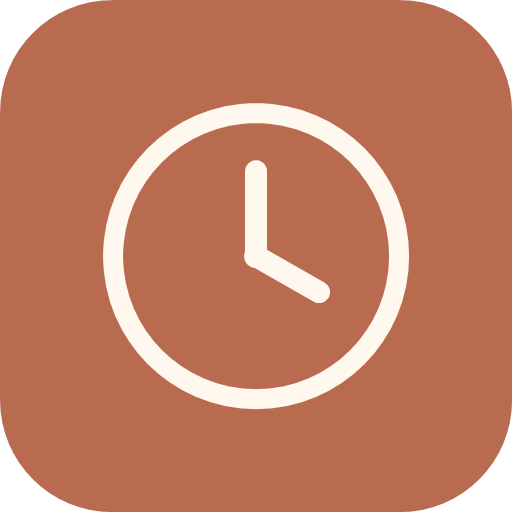
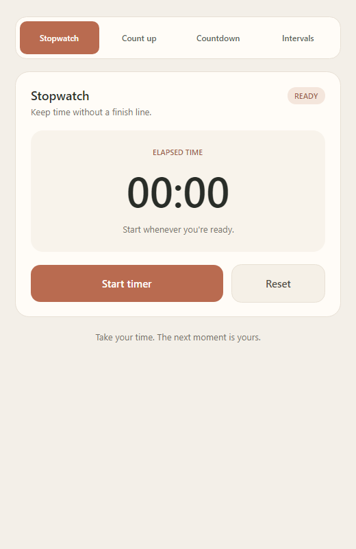
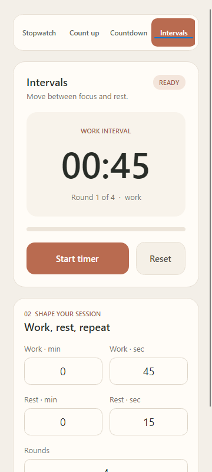

# Stilltime



Stilltime is a timer for Windows and Android, built as an Avalonia UI portfolio project. It has a quiet English interface in warm neutral colors and one shared timing engine for both platforms.

## Preview

These images were rendered from the real Avalonia view with the headless Skia renderer at desktop and narrow mobile widths.

| Desktop · stopwatch | Narrow layout · intervals |
| --- | --- |
|  |  |

## Modes

| Mode | Behavior |
| --- | --- |
| Stopwatch | Counts up without a target. |
| Count up | Counts up to a chosen duration and stops. |
| Countdown | Counts down from a chosen duration to zero. |
| Intervals | Starts with an optional preparation countdown, then alternates work and rest for a chosen number of rounds; the last work period ends the session without a final rest. |

All modes support start, pause, resume, and reset. The duration fields accept up to 999 minutes and 59 seconds, and intervals support 1–99 rounds. Preparation runs once before the first work interval; set it to 0:00 to skip it. The engine uses monotonic timestamps, so a delayed screen refresh does not change the measured time.

Each new timer started from the main controls is saved to local history, including its mode, settings, elapsed time, and final state. Each mode tab shows only its own history, and entries keep their positions when restarted. History remains after restarting the app, and each entry can be deleted. Running entries have a Stop button that ends the current session; paused and stopped entries have a Restart button that restarts the same entry from zero with its saved settings. A timer that was running when the app closed appears as stopped on the next launch. The active timer itself is not resumed after a restart.

History stores up to 10 entries across all modes. Adding a new entry removes the earliest inserted entry when the limit is reached (FIFO). Restarting an existing entry keeps its place in the queue.

## Build and run

Install the .NET 10 SDK. Building for Android also requires the .NET Android workload and Android SDK. The Android target supports Android 6.0 (API 23) or later.

```powershell
dotnet restore Timer.sln
dotnet build Timer.sln -c Debug
dotnet run --project Timer.Desktop
```

To run on Android, select `Timer.Android` and a connected device or emulator in an IDE with Android tooling. The Android project builds from the command line with:

```powershell
dotnet build Timer.Android/Timer.Android.csproj -c Debug
```

## Tests and assets

```powershell
dotnet test Timer.Core.Tests/Timer.Core.Tests.csproj -c Debug
dotnet test Timer.App.Tests/Timer.App.Tests.csproj -c Debug
```

`Timer.Core.Tests` checks timing boundaries, pause and resume behavior, skipped refreshes, interval completion, and history persistence. `Timer.App.Tests` checks mode selection, duration validation, screen commands, and history deletion.

The clock icons are generated by `tools/Generate-Icons.ps1`. The preview images can be regenerated with `tools/Timer.Preview`:

```powershell
& .\tools\Generate-Icons.ps1
dotnet run --project tools/Timer.Preview -- stopwatch 520 docs/screenshots/desktop.png
dotnet run --project tools/Timer.Preview -- intervals 360 docs/screenshots/mobile.png
dotnet run --project tools/Timer.Preview -- verify-input
```

## Project layout

| Path | Purpose |
| --- | --- |
| `Timer.Core/` | Platform-independent timer engine |
| `Timer/` | Shared Avalonia view and view model |
| `Timer.Desktop/` | Windows entry point |
| `Timer.Android/` | Android entry point and resources |
| `Timer.Core.Tests/` | Engine tests |
| `Timer.App.Tests/` | View model tests |
| `tools/` | Icon and screenshot generation |
