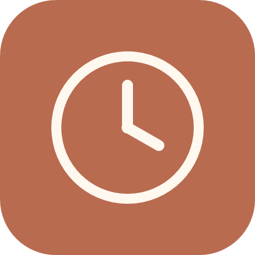
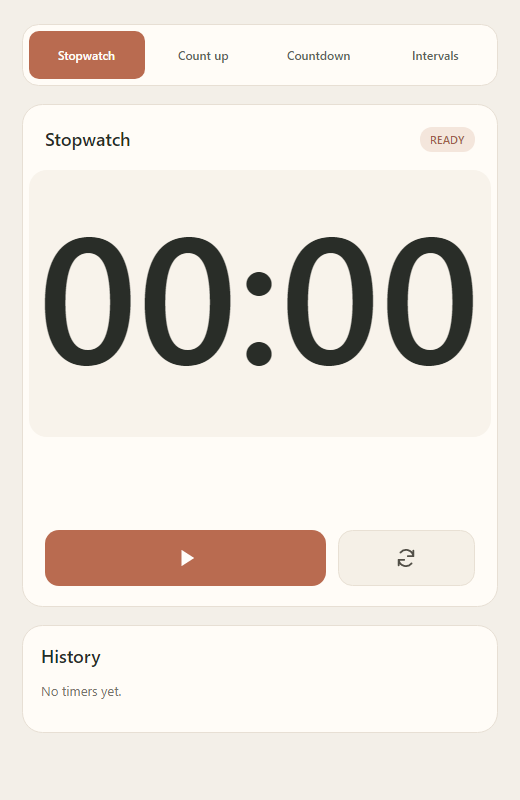
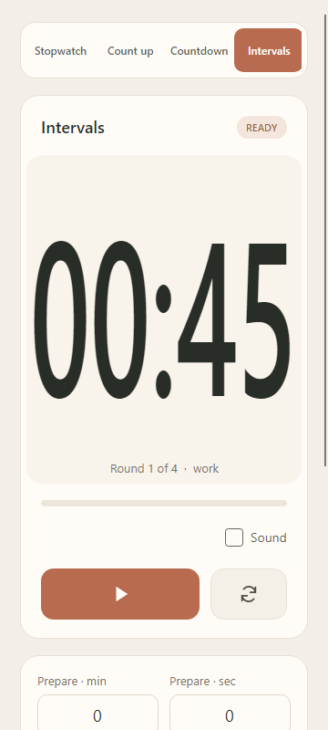

# Stilltime



Stilltime is a timer for Windows, Android, and the browser, built as an Avalonia UI portfolio project.

## Preview

These images were rendered from the real Avalonia view with the headless Skia renderer at desktop and narrow mobile widths.

| Desktop · stopwatch | Narrow layout · intervals |
| --- | --- |
|  |  |

## Downloads

| Platform | Download | How to run |
| --- | --- | --- |
| Windows x64 | [Windows ZIP](https://github.com/HannaPavlenko/Timer/releases/download/v1.0.0/Stilltime-win-x64.zip) | Extract the entire ZIP and open `Timer.Desktop.exe`. The .NET runtime is included. |
| Android 6.0 or later (ARM64 or x86-64) | [Android APK](https://github.com/HannaPavlenko/Timer/releases/download/v1.0.0/Stilltime-android.apk) | Open the downloaded APK and tap **Install**. If prompted, allow your browser or file manager to install this app. |

## Run on Windows

To run from source, install the .NET 10 SDK and run this command from the repository root.

```powershell
dotnet run --project Timer.Desktop
```

## Run in the browser

After GitHub Pages is enabled, open [Stilltime Web](https://hannapavlenko.github.io/Timer/).
On iPhone, open the link in Safari, choose **Share → Add to Home Screen**, and enable **Open as Web App** if offered.
The web version stores history and sound settings on the device. Keep Stilltime visible if you rely on phase cues, because iOS can suspend a background web app.

To run from source with the .NET 10 SDK:

```powershell
dotnet workload restore Timer.Browser/Timer.Browser.csproj
dotnet run --project Timer.Browser
```

The **Publish Stilltime web app** workflow deploys the Release build to GitHub Pages. In the repository settings, set **Pages → Build and deployment → Source** to **GitHub Actions**, then run the workflow if it has not deployed yet.

## Engineering examples

- **Timing across skipped refreshes.** The engine uses monotonic timestamps from `TimeProvider` to find the current interval phase, even when the UI misses a phase transition. [Timer engine](Timer.Core/TimerEngine.cs) · [Skipped-refresh test](Timer.Core.Tests/TimerEngineTests.cs#L66)
- **Recovery from corrupt history.** If the history file is damaged, Stilltime keeps new entries in memory and preserves the original file for recovery. [Session history store](Timer/Storage/SessionHistoryStore.cs) · [Corrupt-history test](Timer.App.Tests/StorageRecoveryTests.cs#L103)
- **One Windows instance per account.** A named mutex protects the running instance across login sessions. A second launch exits before opening history, and a new process can take over after an unexpected exit. [Startup guard](Timer.Desktop/SingleInstanceApplication.cs) · [Process tests](Timer.App.Tests/SingleInstanceTests.cs)

## Modes

| Mode | Behavior |
| --- | --- |
| Stopwatch | Counts up without a target. |
| Count up | Counts up to a chosen duration and stops. |
| Countdown | Counts down from a chosen duration to zero. |
| Intervals | Repeats preparation, work, and rest for a chosen number of rounds, including rest in the final round. |

All modes support start, pause, resume, and reset. The duration fields accept up to 999 minutes and 59 seconds, and intervals support 1–99 rounds. Preparation runs before work in every round; set it to 0:00 to skip it.

The Sound checkbox enables a short beep when Count up or Countdown finishes. In Intervals, Prepare starts with one beep, Work with two, Rest with three, and the session ends with a gong. It is off by default and saved across app restarts. Playback uses the device volume. Starting or restarting Intervals plays the first phase cue; Pause, Resume, Reset, and Stop do not repeat it.

## Run on Android

Install the .NET 10 SDK, the Android workload and the Android SDK. To run the app, select `Timer.Android` and a connected device or emulator in an IDE with Android tooling. The minimum supported version is Android 6.0 (API 23). To build from the command line:

```powershell
dotnet build Timer.Android/Timer.Android.csproj -c Debug
```

## Tests and assets

```powershell
dotnet test Timer.Core.Tests/Timer.Core.Tests.csproj -c Debug
dotnet test Timer.App.Tests/Timer.App.Tests.csproj -c Debug
```

`Timer.Core.Tests` checks timing boundaries, pause and resume behavior, skipped refreshes, interval completion, and history persistence. `Timer.App.Tests` checks mode selection, duration validation, screen commands, and history deletion.

On Windows, `Timer.App.Tests` also starts isolated processes through `tools/Timer.Desktop.TestHost`
to check single-instance exclusion, unchanged history on a rejected launch, normal shutdown,
startup failure, and recovery after the owner process terminates. Test mutex names and history
files are separate from the running application.

The clock icons are generated by `tools/Generate-Icons.ps1`. The preview images can be regenerated with `tools/Timer.Preview`:

```powershell
& .\tools\Generate-Icons.ps1
dotnet run --project tools/Timer.Preview -- stopwatch 520 docs/screenshots/desktop.png
dotnet run --project tools/Timer.Preview -- intervals 360 docs/screenshots/mobile.png
dotnet run --project tools/Timer.Preview -- storage-error 320 artifacts/storage-error.png
dotnet run --project tools/Timer.Preview -- verify-input
```

## Project layout

| Path | Purpose |
| --- | --- |
| `Timer.Core/` | Platform-independent timer engine |
| `Timer/` | Shared Avalonia view and view model |
| `Timer.Desktop/` | Windows entry point |
| `Timer.Android/` | Android entry point and resources |
| `Timer.Core.Tests/` | Engine tests |
| `Timer.App.Tests/` | View model tests |
| `tools/` | Icon and screenshot generation |

## History

Each new timer started from the main controls is saved to local history, including its mode, settings, elapsed time, and final state. Each mode tab shows only its own history sorted by launch date and time, newest first. Restart updates the launch time and moves the same entry to its new chronological position; FIFO storage order stays unchanged. History remains after restarting the app, and each entry can be deleted. Running entries have a Stop button that ends the current session; paused and stopped entries have a Restart button that restarts the same entry from zero with its saved settings. A timer that was running when the app closed appears as stopped on the next launch. The active timer itself is not resumed after a restart.

Edit the name at the top of any history card to name a timer (up to 80 characters). Names are saved automatically and kept when restarting a timer or reopening the app. An empty name shows the timer mode.

History stores up to 10 entries across all modes. Adding a new entry removes the earliest inserted entry when the limit is reached (FIFO). Restarting an existing entry keeps its place in the queue.

Completed Count up, Countdown, and Intervals entries can also be restarted.

## Storage recovery

If history or sound settings cannot be read or saved, the app shows a storage warning and continues
with those changes kept in memory until the app closes. The affected file is not retried during that
session, so a damaged file is not replaced by the temporary history. The other store keeps working.

On Windows, the files are `%LOCALAPPDATA%\Stilltime\history.json` and
`%LOCALAPPDATA%\Stilltime\sound.json`. To recover, close Stilltime, make a backup of the affected
file, then repair it or move it out of that folder. Reopen the app to load the repaired file or start
with an empty history / sound disabled. Moving the file starts fresh; it does not recover its entries.
If access was denied or the disk was full, restore access or free space before reopening.
On Android these files are in private app storage; back up app data before using Android's
Clear storage action, which resets both history and sound settings.
